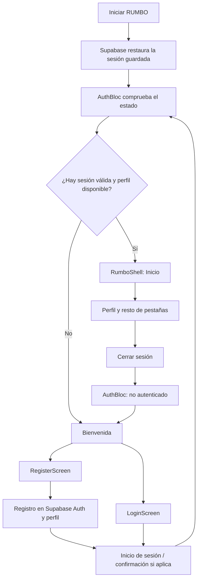
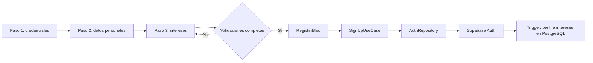
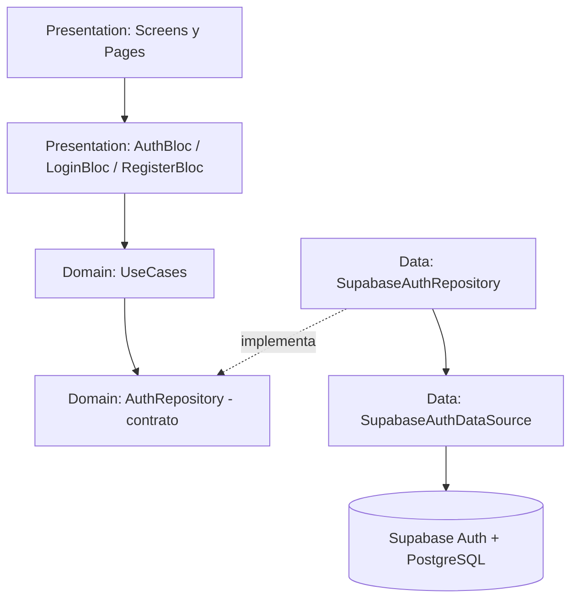
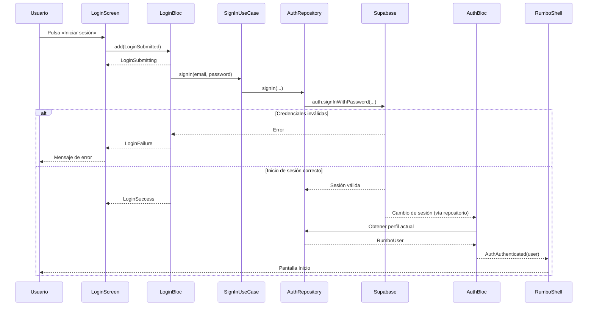

# RUMBO

## 1. Funcionalidades de esta feature 

| Funcionalidad | Comportamiento |
|---|---|
| Registro | Formulario de **3 pasos**: credenciales, datos personales e intereses. |
| Credenciales | Correo, contraseña y confirmación. La política acordada exige al menos 10 caracteres, mayúscula y número; verificar las reglas efectivamente configuradas en Supabase. |
| Datos personales | Nombre completo, teléfono, **username único** y fecha de nacimiento. Se exige una edad mínima de **18 años**. |
| Intereses | Selección de al menos un interés de un catálogo precargado. |
| Login | Inicio de sesión con correo y contraseña; manejo de carga y errores. |
| Sesión | Recuperación y renovación de sesión mediante `supabase_flutter`; `AuthBloc` decide qué interfaz mostrar. |
| Perfil | Resumen con información real del usuario autenticado, recuperada desde Supabase. |
| Roles | Todas las cuentas nuevas se crean como **participante**. Un organizador autorizado puede visualizar el modo participante sin perder sus permisos. |
| Solicitud de organizador | El botón **Quiero ser organizador** presenta un **formulario simulado**. No crea solicitudes ni concede el rol. |

### 1.1. Pantallas y navegación

- **Bienvenida:** permite elegir **Crear cuenta** o **Iniciar sesión** si no existe sesión válida.
- **Registro:** una sola `RegisterScreen` con `PageView` y tres páginas internas.
- **Registro resumen**:  Pantalla resumen del perfil al crear.
- **Login:** `LoginScreen` envía los datos a `LoginBloc`.
- **Aplicación autenticada:** `RumboShell` muestra las pestañas correspondientes al rol, comenzando en **Inicio**.
- **Perfil:** presenta los datos personales y la opción simulada para solicitar ser organizador.

No hay acceso de vista previa sin autenticación en el flujo final del sprint.

## 2. Flujo general de autenticación

> El perfil se carga desde `public.usuario`. Una sesión válida de Supabase no sustituye la existencia del perfil de la aplicación.

## 3. Registro multipágina

| Paso | Página / archivo | Datos |
|---|---|---|
| **1. Credenciales** | `register_credentials_page.dart` | Correo, contraseña, confirmación y aceptación de términos. |
| **2. Háblanos más de ti** | `register_personal_info_page.dart` | Nombre, teléfono, username y fecha de nacimiento (18+). |
| **3. Intereses** | `register_interests_page.dart` | Selección de uno o más intereses. |

`RegisterScreen` controla el `PageView`, conserva las entradas al cambiar de página y, al finalizar, envía un `RegisterSubmitted` con un `RegisterDraft` a `RegisterBloc`. El envío a Supabase solo ocurre al finalizar los tres pasos.

La validación de formularios mejora la experiencia de usuario, pero las restricciones definitivas (username único, edad mínima y relaciones) también deben aplicarse en PostgreSQL.

## 4. Clean Architecture y BLoC

### 4.1. Capas

**Responsabilidades:**

- **Presentation:** widgets, validaciones de formulario, eventos y estados BLoC.
- **Domain:** `RumboUser`, `RegisterDraft`, contrato `AuthRepository` y casos de uso (`SignUpUseCase`, `SignInUseCase`, `GetCurrentProfileUseCase` y casos de sesión).
- **Data:** repositorio concreto y fuente de datos que interactúan con Supabase.
- **App:** composición manual de los objetos y navegación global mediante `RumboApp` y `RumboShell`.

> En el Sprint 1 se usan constructores e instanciación manual. **No se incluye contenedor ni framework de inyección de dependencias**; esa mejora queda para el Sprint 2.

### 4.2. Flujo de eventos y estados BLoC

**BLoC implementados:**

| BLoC | Eventos principales | Estados principales | Ámbito |
|---|---|---|---|
| `AuthBloc` | `AuthStarted`, `AuthSessionChanged`, `AuthRetryRequested`, `AuthSignOutRequested` | `AuthInitial`, `AuthLoading`, `AuthAuthenticated`, `AuthUnauthenticated`, `AuthFailure` | Global, disponible desde `RumboApp`. |
| `LoginBloc` | `LoginSubmitted` | `LoginInitial`, `LoginSubmitting`, `LoginSuccess`, `LoginFailure` | Pantalla de inicio de sesión. |
| `RegisterBloc` | `RegisterSubmitted` | `RegisterInitial`, `RegisterSubmitting`, `RegisterSuccess`, `RegisterFailure` | Registro de tres pasos. |

`BlocProvider` hace disponible cada BLoC a los widgets correspondientes. Las pantallas envían eventos con `context.read<...>().add(...)` y utilizan `BlocConsumer`/`BlocBuilder` para reaccionar a los estados. **La sesión y los tokens los persiste Supabase, no el BLoC**.

## 5. Supabase y modelo de datos

Se emplean **Supabase Auth** para las credenciales y sesiones y **PostgreSQL** para los perfiles e intereses.

Tablas principales de este sprint:

| Tabla | Contenido |
|---|---|
| `auth.users` | Usuarios gestionados por Supabase Auth. |
| `public.usuario` | Identidad de RUMBO: UUID, nombre, correo, teléfono, username, fecha de nacimiento, rol y fecha de registro. |
| `public.interes` | Catálogo precargado de intereses. |
| `public.usuario_interes` | Relación de los intereses seleccionados con cada usuario. |

El perfil se enlaza con `auth.users.id` mediante un UUID. La migración incluye restricciones de **username único**, **mayoría de edad**, el rol inicial **participante**, un trigger para registrar el perfil al crear la cuenta y políticas **Row Level Security (RLS)** para consultar datos propios.

**Roles:** el permiso `organizador` no se obtiene pulsando el botón «Quiero ser organizador». Ese botón solamente muestra **«Formulario simulado»**. La aprobación real se desarrollará posteriormente. Las cuentas organizadoras empleadas en la demostración deben estar autorizadas por un mecanismo administrativo controlado.
